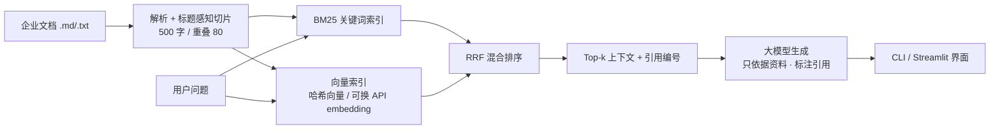

# 企业知识库 RAG 问答系统

> 把企业文档变成"能回答、能溯源"的问答助手：**标题感知切片 → BM25 + 向量混合检索（RRF 融合）→ 大模型带引用生成**，附检索评测脚本、单元测试和 Streamlit 演示界面。

  

---

## 1. 解决什么问题

企业知识散落在产品手册、FAQ、制度文档里，客服和新员工只能全文搜索、逐篇翻找；直接问通用大模型又容易"编"，而且没有出处、无法追责。

本项目把文档做成一个**可溯源的知识库问答服务**：
- 回答必须来自检索到的原文，并标注引用编号（[1][2]）；
- 资料不足时明确说"无法确定"，而不是编造；
- 检索效果有**可量化评测**（Hit@k / MRR），而不是"感觉还行"。

## 2. 架构



关键设计：
- **标题感知切片**：按 Markdown 标题切段，尽量让"一个二级标题"独立成块，长段再按句子切并保留标题前缀——避免"私有化最低配置"这种关键段被切碎。
- **混合检索**：BM25 保关键词命中，向量检索兜语义改写，再用 RRF（Reciprocal Rank Fusion）融合，比单一召回稳。
- **零依赖可复现**：默认用字符 n-gram 哈希向量 + 纯 Python BM25，不装 torch / 向量库也能跑；需要更强语义时一行环境变量切到 API embedding。
- **可插拔生成**：任何 OpenAI 兼容接口（DeepSeek / 通义兼容模式 / 硅基流动 / 本地 ollama）都能接；没配 Key 时自动降级为抽取式回答，保证 demo 永远能演示。

## 3. 目录结构

```text
rag-kb-demo/
├─ app.py                     # Streamlit 演示界面
├─ requirements.txt
├─ .env.example               # 大模型 / embedding 配置模板
├─ src/
│  ├─ text.py                 # 分词（中英混合）、标题感知切片
│  ├─ embedder.py             # 哈希向量（零依赖）/ API embedding
│  ├─ index.py                # BM25 + 向量 + RRF 混合检索、索引持久化
│  ├─ llm.py                  # OpenAI 兼容对话接口（urllib，零依赖）
│  ├─ pipeline.py             # RAG 主流程（检索→上下文→生成/降级）
│  └─ evaluate.py             # Hit@k / MRR 评测与报告渲染
├─ scripts/
│  ├─ build_index.py          # 建索引
│  ├─ ask.py                  # 命令行问答
│  └─ evaluate.py             # 跑评测，输出 Markdown 报告
├─ data/
│  ├─ docs/                   # 知识库文档（示例为虚构产品"智擎云"6 篇）
│  ├─ eval/                   # 评测集：questions.jsonl（关键词问法）+ paraphrase.jsonl（口语化问法）
│  └─ index/                  # 构建产物（已 gitignore）
├─ tests/test_pipeline.py     # 7 个单元测试
└─ reports/                   # 评测报告（已 gitignore）
```

## 4. 快速开始

要求 Python 3.10+，核心只依赖 numpy。

```bash
# 1) 安装依赖
python -m pip install -r requirements.txt

# 2) 构建索引
python scripts/build_index.py

# 3) 命令行问答（不配大模型 Key 也能跑，返回检索摘录）
python scripts/ask.py "私有化部署需要什么配置？"

# 4) 跑检索评测
python scripts/evaluate.py --mode hybrid

# 5) 可选：网页演示
python -m pip install streamlit
streamlit run app.py
```

接大模型生成（可选）：复制 `.env.example` 为 `.env` 填入 Key，或在 PowerShell 里设置：

```powershell
$env:LLM_BASE_URL = "https://api.deepseek.com/v1"
$env:LLM_API_KEY  = "sk-xxxx"
$env:LLM_MODEL    = "deepseek-chat"
python scripts/ask.py "你们支持私有化部署吗？"
```

## 5. 评测结果

评测方法：每个问题标注 1 个 `gold_doc`（正确来源文档），统计检索结果里 gold 文档的名次，计算 Hit@k 与 MRR。两套题：**10 题关键词问法** + **6 题口语化改写**（同一知识点的换一种问法）。

| 问法 | 检索模式 | Hit@1 | Hit@3 | Hit@5 | MRR |
|---|---|---|---|---|---|
| 关键词（10 题） | BM25 | 90.0% | 100% | 100% | 0.950 |
| 关键词（10 题） | 向量 | 80.0% | 100% | 100% | 0.900 |
| 关键词（10 题） | **混合（默认）** | **90.0%** | 100% | 100% | **0.950** |
| 口语化（6 题） | BM25 | 83.3% | 83.3% | 83.3% | 0.833 |
| 口语化（6 题） | 向量 | 50.0% | 83.3% | 83.3% | 0.639 |
| 口语化（6 题） | **混合（默认）** | **83.3%** | 83.3% | **100%** | **0.875** |

结论：
- 小语料上关键词检索本身就很强（关键词问法 90% Hit@1）；
- **口语化问法上混合检索把 Hit@5 从 83.3% 拉到 100%、MRR 最高**——这正是"关键词搜不到、语义能兜底"的价值，也是引入混合检索的量化依据。

复现：`python scripts/evaluate.py --mode hybrid`（报告写入 `reports/eval_report.md`；口语化题集用 `--questions data/eval/paraphrase.jsonl`）。

## 6. 设计决策（答辩时会被问）

1. **为什么切片 500 字、重叠 80？** FAQ/制度类文档段落通常 200-600 字，500 字能装下一个完整小节；重叠 80 字避免答案跨块被截断。切片过短会丢上下文，过长会稀释相似度、增加生成成本。
2. **为什么 BM25 + 向量混合，而不是只上向量？** 企业文档里大量专有名词、错误码、型号（如 429、AES-256、9.8 万元），关键词命中非常关键；纯向量对这类精确匹配反而弱。RRF 不需要调权重、两路结果鲁棒融合，是工程上性价比最高的方案。
3. **为什么默认哈希向量？** 零依赖、确定性、可跑通全流程，答辩演示不依赖 GPU/网络；`RAG_EMBEDDER=api` 可切 bge-m3 等真实 embedding，需要时再升级。
4. **怎么控制幻觉？** 系统提示约束"只能依据参考资料、必须标引用、资料不足就说无法确定"；检索 Top-k 不足时直接返回"未检索到"。后续可加引用校验（答案里的 [n] 必须对应真实切片）。
5. **成本与延迟？** 检索在 31 个切片上平均 0.1 ms；主要成本是生成 token，因此 Top-k 默认 5、上下文截断，并支持缓存（见路线图）。

## 7. 换成你自己的领域（3 步）

1. 把 `data/docs/` 里的示例文档换成你的领域文档（支持 `.md` / `.txt`；PDF/Word 先转成 Markdown 再放进来）；
2. 更新 `data/eval/questions.jsonl`（每题写 `question` + `gold_doc` 文件名）；
3. 重跑 `python scripts/build_index.py` 和 `python scripts/evaluate.py`，把新指标写进简历。

## 8. 简历怎么写

> **企业知识库 RAG 问答系统**（个人项目，2026.11）
> - 独立设计并实现文档问答系统：标题感知切片 + BM25/向量混合检索（RRF）+ 大模型带引用生成，支持任意 OpenAI 兼容模型接入。
> - 构建 16 题标注评测集，混合检索在口语化问法上 Hit@5 达 100%（较单路关键词检索 +16.7pp），关键词问法 Hit@1 90%、MRR 0.95。
> - 工程化：索引持久化、CLI + Streamlit 双入口、7 个单元测试、零依赖降级策略（无 API Key 也能演示）。

English bullet（投外企可用）：

> Built a retrieval-augmented QA system over enterprise docs: heading-aware chunking, hybrid BM25 + vector retrieval with RRF, and citation-grounded LLM generation. Created a 16-question labeled eval set; hybrid retrieval reached 100% Hit@5 on paraphrased queries (+16.7pp vs BM25-only) with 0.95 MRR on keyword queries. Shipped CLI + Streamlit demo, index persistence, and 7 unit tests.

## 9. 3 分钟演示脚本

见 `docs/演示脚本.md`。

## 10. 改进路线图（答辩时显得有规划）

- [ ] Cross-encoder rerank（bge-reranker）提升 Top-3 精度
- [ ] Query 改写 / 多轮指代消解（历史消息压缩）
- [ ] 引用校验：答案中的 [n] 必须能在上下文找到
- [ ] 缓存（相同问题命中缓存）+ 流式输出
- [ ] Docker 化 + 简单可观测性（QPS、P95、命中率）
- [ ] 接入真实 embedding 与更大规模语料，评测扩展到 50+ 题

## 11. 许可

仅用于学习与赛事展示。示例文档中的"智擎云"为虚构产品，仅作演示。
